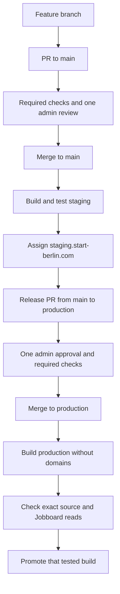

# Website release

## Selected hosting

Use the new `website-v2` project in the START Berlin Vercel team, project ID `prj_kamZS2JZZFZNqzw34uJU3xbbEPkO`. The current live `start-berlin.com` project remains the legacy site's host until the approved cutover. Never copy its project.json into V2.

GitHub Actions uploads the checked-out source through the Vercel CLI. The Vercel project has no Git repository connection and the shared START account must not receive a personal GitHub sign-in connection. The deployment guard rejects a restored Vercel Git connection. GitHub organisation membership for PRs/code review remains independent of Vercel authentication.

The repository is public by Jannik's instruction on 10 October 2026. This permits GitHub Free branch rules and environment policies. Separate technical rulesets cover `main` and `production`, with no bypass actors: every change requires a PR, resolved discussions and Required checks from GitHub Actions. Main must also be up to date. Review-only rulesets require one admin code-owner review for ordinary contributors. As explicitly requested by Jannik, repository admins can authorize any PR through intentional merge, including their own. Their bypass applies only to the review-only ruleset and only on PR merges; CI remains mandatory. A separate Approve review cannot be submitted by the PR author.

Vercel supports collaboration on public repositories under Hobby. This does not add shared dashboard team seats; the contributors work through GitHub PRs and deployment previews. See the [collaboration rules](https://vercel.com/docs/deployments/troubleshoot-project-collaboration) and [Hobby plan comparison](https://vercel.com/docs/plans/hobby).

Production has only a `production` deployment branch policy and no required environment reviewer. The release PR is the single human production approval. Staging and PR-preview environments accept workflow runs from `main` only. Tokens default to read access. GitHub's combined create/approve setting permits the release bot to open PRs; a bot vote does not satisfy the human admin CODEOWNERS rule or the production review guard.

## Flow

Git-triggered Vercel deployments are disabled in vercel.json. GitHub Actions owns deployment ordering. Vercel production domain auto-assignment is disabled too. CI uses remote source builds so build-time Vercel system variables are available. It never promotes a Preview build as if it were the tested production artifact: promotion of a staged Production deployment keeps that build, whereas promoting Preview causes a rebuild.

The build embeds the Git commit and source-tree identities in `/api/health`, with no-store caching. It also reports the actual Node major. Hosted smoke and the isolated packaged function require that major to match the CI runtime; the package targets the same major in its Vercel function configuration. All workflow runners read Node from `package.json`, whose engine is `22.x`, matching the Vercel project. An open-ended minimum may override the project with a newer, untested major. [Vercel version selection](https://vercel.com/docs/functions/runtimes/node-js/node-js-versions) explains this precedence. Health is application liveness only. Smoke checks separately read the built pages and verify the legal redirects. Staging may show the explicit Jobs unavailable state while integrations are still being completed; Production requires a successful Jobs read. None of these checks submits a real employer form, registers an applicant or proves email delivery. The Production guard accepts a current admin review or a verified human admin as the release-PR merger, while still enforcing the exact staged source and branch controls.

CI plans verification from the changed files and test imports. It discovers new test files and package.json check/test scripts automatically. The built-server smoke pass discovers current Astro pages from src/pages, so a newly implemented page joins route verification without a fixed URL list. Parameterised pages need their domain fixtures and behaviour tests. Documentation-only changes skip website builds; dependency changes and releases run the complete suite. The final Required checks status always reports whether the selected plan succeeded.

The Vercel build also starts the packaged Node function from an isolated temporary directory and verifies its embedded health identity, without access to checkout dependencies. This catches runtime imports that a build alone misses. The adapter is pinned to 11.0.12 while 11.0.13 has a [confirmed runtime bundler-import regression](https://github.com/withastro/astro/issues/18328); future adapter updates must pass the same packaged-function check. HTTP smoke uses the full deployment URL and does not pass `--non-interactive` to `vercel curl`, because CLI 63.1.2 forwards that option to native curl.

## Activation

After assigning a stable public alias, health may briefly come from its previous deployment. Guest verification makes at most eight health reads, two seconds apart, and still requires the exact expected commit/tree. Immutable deployment URLs fail a source mismatch immediately. Invalid health, cached responses and transport/authentication failures are never accepted by this waiting window.

The workflows start disabled. Keep `DEPLOYMENTS_ENABLED=false` and `PRODUCTION_RELEASE_ENABLED=false` until the following configuration is verified. A true flag alone cannot bypass the GitHub or Vercel configuration guards.

1. Merge the pipeline PR after Required checks and one admin review. Keep the bootstrap `production` branch at its existing source until the first release PR. `staging` is a reserved branch name, not another development branch.
   Deploy staging's manual `verify_only` mode checks the complete current source and actual GitHub controls without a deployment. It can run while deployment activation is off, and cannot count as successful staging.
2. Keep Vercel's Git connection absent. Actions uploads source to the reviewed project using explicit project/team IDs and the project-scoped START Website CI token. Do not add `--scope`: CLI scope resolution queries a user profile that project tokens cannot access. Alias assignment and Production promotion use the Vercel API with explicit team/project/deployment IDs and verify the ready deployment's project, commit and environment before publishing. GitHub's `production` branch controls releases; CLI deployment metadata records that branch. Keep automatic production domain assignment off and use Node.js 22. The pinned install/build commands in vercel.json select pnpm 11.25.0 explicitly because a bare override may use an older pnpm.
3. Associate `staging.start-berlin.com` with Preview and the reserved `staging` branch. CI deploys with Git metadata `main` and assigns the alias only after smoke checks. This prevents a build from updating the stable staging domain early. PR previews use their actual feature branch and never assign the staging domain.
   Keep Vercel Authentication at Standard Protection, with exactly the fixed staging domain as a Deployment Protection Exception. Jannik selected this public staging/private individual-Preview policy. Stable staging and the final public Production domain are checked without automation credentials, so an authenticated success cannot hide a guest login requirement.
   Vercel classifies the first deployment of a new project as Production even when Preview is requested ([documented initial-deployment behaviour](https://vercel.com/docs/domains/working-with-domains/deploying-and-redirecting)). The Preview-result guard rejects that initialization before assigning staging. Keep live domains on the legacy project and custom-domain auto-assignment disabled, retain the initialization, then rerun the same reviewed main source. The next deployment must actually be Preview and pass smoke checks. The initializer uses the preview noindex header and is not an accepted Production release.
4. Set repository variables `VERCEL_ORG_ID` and `VERCEL_PROJECT_ID` to the verified new project. An admin configures `VERCEL_TOKEN` directly in each deployment environment. Do not put a token in PR CI, repository source or a --token command argument. Automated HTTP checks use `vercel curl` with that existing Vercel authentication, so protection remains enabled without manually copying a second bypass secret. Direct-HTTP operational checks can optionally use an existing `VERCEL_AUTOMATION_BYPASS_SECRET`.
   Disable automatic system environment exposure in the V2 project. Vercel requires one automation bypass to be designated as its system environment variable; leaving automatic exposure on would give it to PR application code. The deployment guard rejects that setting, and health/smoke verify that neither the CI token nor the automation bypass exists in application runtime. Application origins/indexing and build commit/tree are set explicitly; public preview configuration remains separate from deployment credentials.
5. Configure Preview with public Config values only, with no service credentials on any branch. Removing a Git connection can affect branch-specific configuration, so this pipeline does not rely on branch-specific secret isolation. New public Config names require no guard edit. Set `PUBLIC_SITE_URL` to `https://staging.start-berlin.com` for Preview; Production uses `https://www.start-berlin.com`. Keep metrics disabled. Production read/submit keys must be distinct and scoped; the public website gets no database connection. Test integrations on the prepared Production candidate before assigning live domains. Staging/PRs use the controlled Jobs unavailable state or local test fixtures.
6. Enable `DEPLOYMENTS_ENABLED` and run Deploy staging on `main`. Both push-triggered and manually started staging runs count only when their deployment job completes successfully, including stable-domain verification. Verify the deployment URL and stable domain against the exact source commit/tree, with noindex headers. Leave `PRODUCTION_RELEASE_ENABLED=false` until relaunch acceptance and the domain cutover are approved.

Individual PR previews follow successful CI automatically once deployments are enabled and the first main staging deployment has succeeded. This establishes the project with reviewed source before any PR build. A contributor with Write access can request a fresh preview through Deploy PR preview on main, specifying the PR number. The guard checks current contributor permission, an open same-repository PR and successful CI for that exact head. The preview source executes on Vercel, outside the credential-bearing GitHub runner. The CLI and deployment configuration come from reviewed main. Production approval still belongs to exactly one admin in the release PR.

The pinned CLI runs explicitly in JSON/non-interactive mode. Parse its ready deployment object before using the URL, and reject incomplete responses or the wrong environment. In particular, a Production deployment must never count as a PR Preview. Always pass the reviewed project ID explicitly, including when the PR contains a local Vercel configuration file.

The release bot opens its PR after successful staging. GitHub may require a human to approve workflow execution on a bot-created PR. Use the Approve workflows to run banner and wait for Required checks; do not count a skipped or approval-pending run as successful CI.

## Relaunch and domains

Complete the remaining product acceptance in the parent working plan before enabling production: Newsletter and Cockpit Jobboard backend, current Join content, remaining linked routes and the migrated legal/privacy text. The Cockpit main snapshot reviewed on 10 October has no public Jobboard API routes; source integration in V2 does not establish that the backend is deployed.

Verify phones and tablets plus desktop layouts, member filters and selected external application/contact destinations. Exercise submissions and delivery through the intended hosts with agreed test records; document real results separately from GET-only smoke checks.

For the first cutover, record the legacy project's current production deployment and domain associations. Merge the single-admin-approved release PR while `PRODUCTION_RELEASE_ENABLED=false`, then run Deploy production on `production` with mode `prepare`. This runs the full checks and approval guard, creates a Production build with no domain assignment, and tests its exact source and Jobboard read. Its summary records the tested URL, commit and tree. A Preview build is not a substitute.

Complete acceptance on that candidate. During the approved cutover window, promote that exact tested Production build in the new project while its only production domain is the generated Vercel domain. Then reassign `www.start-berlin.com` and `start-berlin.com` to V2, with the apex redirecting to www. Verify both domains, HTTPS and legacy redirects against the candidate before enabling `PRODUCTION_RELEASE_ENABLED`. Preserve email-related DNS records and use the actual DNS requirements Vercel returns. Keep the legacy project and deployment as the recovery target. Subsequent releases use `publish`; its guard requires the verified www domain to belong to V2 before publication. The release PR remains the only human admin approval; preparing a candidate adds no second approval gate.

If V2 fails after the first domain move, reassign both domains to the recorded legacy project/deployment. Once V2 has established releases, use `vercel rollback` to a known V2 Production deployment instead. Code rollback does not reverse backend migrations or restore external submissions. After a rollback, Vercel may stop automatic assignment until a later explicit promotion; this pipeline always promotes explicitly.

## Sources

- [Authenticated HTTP checks without manual bypass-secret management](https://vercel.com/docs/cli/curl)
- [Vercel deploy and skip-domain](https://vercel.com/docs/cli/deploy)
- [Production promotion and Preview rebuilds](https://vercel.com/docs/deployments/promoting-a-deployment)
- [Branch-specific domains](https://vercel.com/docs/domains/working-with-domains/assign-domain-to-a-git-branch)
- [Vercel package-manager overrides](https://vercel.com/docs/package-managers)
- [Official Astro Vercel adapter](https://docs.astro.build/en/guides/integrations-guide/vercel/)
- [GitHub rulesets](https://docs.github.com/en/repositories/configuring-branches-and-merges-in-your-repository/managing-rulesets/about-rulesets)
- [GitHub environment policies](https://docs.github.com/en/actions/reference/workflows-and-actions/deployments-and-environments)
- [Workflow execution for bot-created PRs](https://docs.github.com/en/actions/how-tos/write-workflows/choose-when-workflows-run/trigger-a-workflow)
