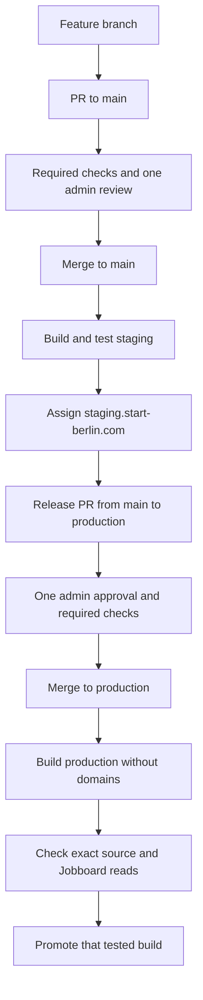

# Website release

## Selected hosting

Use the new `website-v2` project in the START Berlin Vercel team, project ID `prj_kamZS2JZZFZNqzw34uJU3xbbEPkO`. The current live `start-berlin.com` project remains the legacy site's host until the approved cutover. Never copy its project.json into V2.

The repository is public by Jannik's instruction on 10 October 2026. This permits GitHub Free branch rules and environment policies. The active rulesets cover `main` and `production`, with no bypass actors. Each requires one code-owner approval, resolved discussions and the Required checks status from GitHub Actions. Feature PRs must also be up to date with main and have approval of the latest push. Production permits the already-reviewed main source without requiring a second admin to approve the merge operator's push.

Production has only a `production` deployment branch policy and no required environment reviewer. The release PR is the single human production approval. Staging and PR-preview environments accept workflow runs from `main` only. Tokens default to read access and workflows cannot approve PR reviews.

## Flow

Git-triggered Vercel deployments are disabled in vercel.json. GitHub Actions owns deployment ordering. Vercel production domain auto-assignment is disabled too. CI uses remote source builds so build-time Vercel system variables are available. It never promotes a Preview build as if it were the tested production artifact: promotion of a staged Production deployment keeps that build, whereas promoting Preview causes a rebuild.

The build embeds the Git commit and source-tree identities in `/api/health`, with no-store caching. Health is application liveness only. Smoke checks separately read the built pages and verify the legal redirects. Staging may show the explicit Jobs unavailable state while integrations are still being completed; Production requires a successful Jobs read. None of these checks submits a real employer form, registers an applicant or proves email delivery.

CI plans verification from the changed files and test imports. It discovers new test files and package.json check/test scripts automatically. The built-server smoke pass discovers current Astro pages from src/pages, so a newly implemented page joins route verification without a fixed URL list. Parameterised pages need their domain fixtures and behaviour tests. Documentation-only changes skip website builds; dependency changes and releases run the complete suite. The final Required checks status always reports whether the selected plan succeeded.

## Activation

The workflows start disabled. Keep `DEPLOYMENTS_ENABLED=false` and `PRODUCTION_RELEASE_ENABLED=false` until the following configuration is verified. A true flag alone cannot bypass the GitHub or Vercel configuration guards.

1. Merge the pipeline PR after Required checks and one admin review. Keep the bootstrap `production` branch at its existing source until the first release PR. `staging` is a reserved branch name, not another development branch.
2. Connect Vercel to `startberlin/website-v2`, set Production branch to `production`, keep automatic production domain assignment off and use Node.js 22. The pinned install/build commands in vercel.json select pnpm 11.25.0 explicitly because a bare override may use an older pnpm.
3. Associate `staging.start-berlin.com` with Preview and the reserved `staging` branch. CI deploys with Git metadata `main` and assigns the alias only after smoke checks. This prevents a build from updating the stable staging domain early. PR previews use their actual feature branch and never assign the staging domain.
4. Set repository variables `VERCEL_ORG_ID` and `VERCEL_PROJECT_ID` to the verified new project. An admin configures `VERCEL_TOKEN` directly in each deployment environment. Do not put a token in PR CI, repository source or a --token command argument. Configure `VERCEL_AUTOMATION_BYPASS_SECRET` in deployment environments only if Vercel protection requires it; leave deployment protection enabled.
5. Configure Preview's private Cockpit values only for the `main` branch. Other PR branches receive no shared service credentials. Set `PUBLIC_SITE_URL` to `https://staging.start-berlin.com` for main Preview; Production uses `https://www.start-berlin.com`. Keep metrics disabled. Production read/submit keys must be distinct and scoped; the public website gets no database connection.
6. Enable `DEPLOYMENTS_ENABLED` and run staging. Verify the deployment URL and stable domain against the exact source commit/tree, with noindex headers. Leave `PRODUCTION_RELEASE_ENABLED=false` until relaunch acceptance and the domain cutover are approved.

Individual PR previews follow successful CI automatically once deployments are enabled. A contributor with Write access can request a fresh preview through Deploy PR preview on main, specifying the PR number. The guard checks current contributor permission, an open same-repository PR and successful CI for that exact head. The preview source executes on Vercel, outside the credential-bearing GitHub runner. The CLI and deployment configuration come from reviewed main. Production approval still belongs to exactly one admin in the release PR.

The release bot opens its PR after successful staging. GitHub may require a human to approve workflow execution on a bot-created PR. Use the Approve workflows to run banner and wait for Required checks; do not count a skipped or approval-pending run as successful CI.

## Relaunch and domains

Complete the remaining product acceptance in the parent working plan before enabling production: Newsletter and Cockpit Jobboard backend, current Join content, remaining linked routes and the migrated legal/privacy text. The Cockpit main snapshot reviewed on 10 October has no public Jobboard API routes; source integration in V2 does not establish that the backend is deployed.

Verify phones and tablets plus desktop layouts, member filters and selected external application/contact destinations. Exercise submissions and delivery through the intended hosts with agreed test records; document real results separately from GET-only smoke checks.

For the first cutover, record the legacy project's current production deployment and domain associations. Stage and test a V2 Production build before moving any existing website domain. Configure the apex redirect to www, preserve all email-related DNS records and use the actual DNS requirements Vercel returns. Reassign only `start-berlin.com` and `www.start-berlin.com` to V2 during the approved window, then promote and verify both domains, HTTPS and legacy redirects. Keep the legacy project and deployment as the recovery target.

If V2 fails after the first domain move, reassign both domains to the recorded legacy project/deployment. Once V2 has established releases, use `vercel rollback` to a known V2 Production deployment instead. Code rollback does not reverse backend migrations or restore external submissions. After a rollback, Vercel may stop automatic assignment until a later explicit promotion; this pipeline always promotes explicitly.

## Sources

- [Vercel deploy and skip-domain](https://vercel.com/docs/cli/deploy)
- [Production promotion and Preview rebuilds](https://vercel.com/docs/deployments/promoting-a-deployment)
- [Branch-specific domains](https://vercel.com/docs/domains/working-with-domains/assign-domain-to-a-git-branch)
- [Vercel package-manager overrides](https://vercel.com/docs/package-managers)
- [Official Astro Vercel adapter](https://docs.astro.build/en/guides/integrations-guide/vercel/)
- [GitHub rulesets](https://docs.github.com/en/repositories/configuring-branches-and-merges-in-your-repository/managing-rulesets/about-rulesets)
- [GitHub environment policies](https://docs.github.com/en/actions/reference/workflows-and-actions/deployments-and-environments)
- [Workflow execution for bot-created PRs](https://docs.github.com/en/actions/how-tos/write-workflows/choose-when-workflows-run/trigger-a-workflow)
