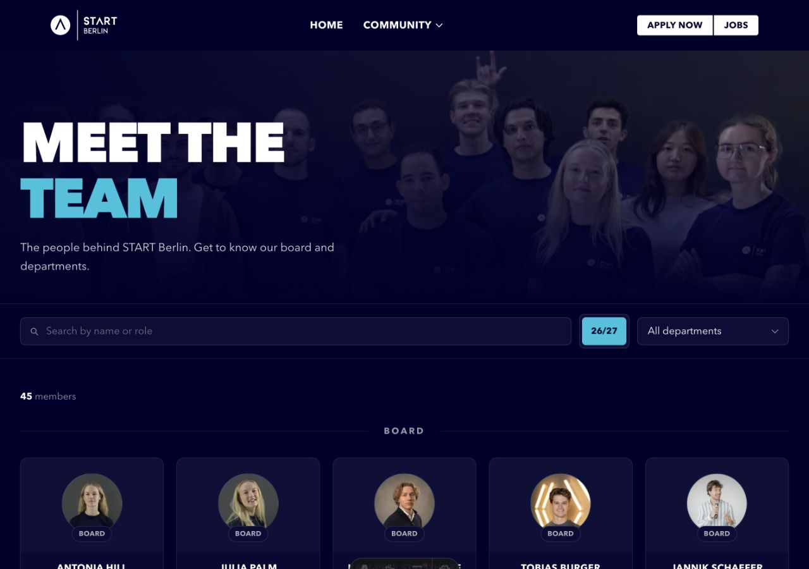
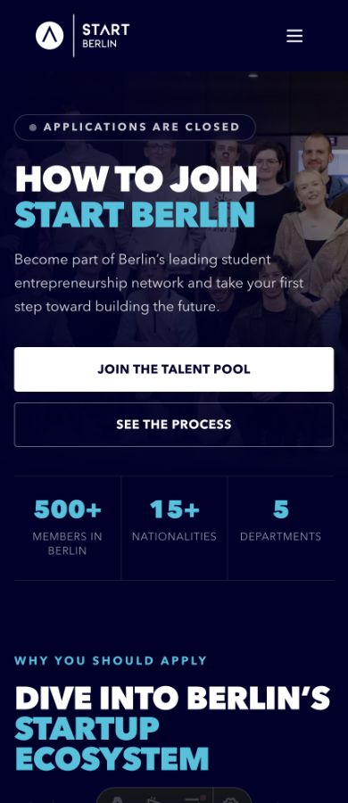
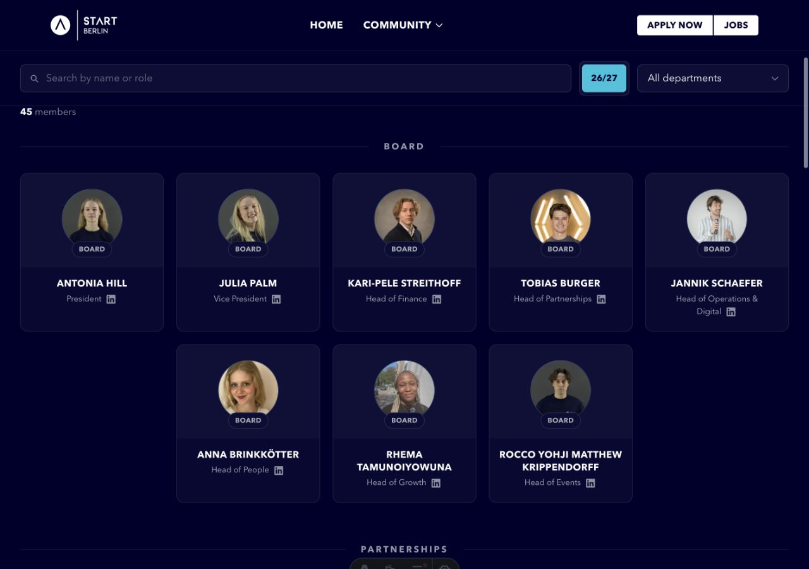

# Members and shared photo heroes

Updated 30 September 2026.

The members directory contains 45 people in season 26/27. The corrected roster removes Paul Steinau, Bo Ehrich, Marta Kielpinski and Kalina Petrykowska. There are 44 LinkedIn profiles and 43 local portraits. Seoyoung's profile lookup was skipped on request. Daria has a LinkedIn destination and an initials avatar.

`src/data/team.json` stores season roles and departments. `src/data/member-profiles.json` stores each person's public profile URL and optional portrait filename. Profile keys match the roster names. Board heads reuse the same record and portrait in both listings. The two JSON files total 8,682 bytes; portrait sources total 230,764 bytes. The page remains prerendered, with lazy 96- and 192-pixel WebP portraits.

The LinkedIn SVG sits beside the role. Its visible size is 14 pixels and its touch target is 44 pixels. Focus is visible, and hover uses the site accent colour. Links include `utm_source=start-berlin.com`, `utm_medium=referral`, `utm_campaign=members` and a person-specific `utm_content`. These parameters identify referral traffic; they do not create a separate click analytics service.

Department and Board badges overlap the portrait's lower edge. One- and two-line badges retain at least 23 pixels before the name. Search includes the default Member role. The result count sits below the filters and counts people once across repeated Board and department cards. Invalid season parameters fall back to the newest populated season.

`PageHero.astro` shares the photo gradients, typography and content spacing across Home, Join, Members and Jobs. Home keeps its taller landing variant and slideshow; reduced-motion preferences prevent rotation. Members reuses the existing `hero-3.jpg`. Responsive WebP widths are bounded by the original image resolution. The two Join hero buttons have equal width and 50-pixel height below 640 pixels. The Join statistics fit at 320 pixels.

## Verification

Astro typechecking passed with zero errors and zero warnings; three existing Zod deprecation hints remain. The production build passed using `.astro/members-build`, preserving tracked `dist/`. The 47 existing Jobboard helper/API/route tests pass with mocked provider responses.

Browser verification covers 26 hero/breakpoint combinations and all 50 member cards at six CSS widths from 320 to 1440 pixels. There are no horizontal overflows or clipped card labels. Search and department filters update the unique-person count correctly. The four mobile Join button checks include the 639/640-pixel boundary. All 86 portrait variants and all 11 inspected photo-hero variants returned HTTP 200.

- [Members card checks](verification/member-badges-2026-09-30/browser-qa.json)
- [Portrait storage and delivery](verification/member-badges-2026-09-30/storage-image-qa.json)
- [Hero checks](verification/page-heroes-2026-09-30/browser-qa.json)
- [Button checks](verification/page-heroes-2026-09-30/join-buttons-qa.json)
- [Unique-person count checks](verification/page-heroes-2026-09-30/member-count-qa.json)
- [Production artifact checks](verification/page-heroes-2026-09-30/build-qa.json)
- [Hero image delivery](verification/page-heroes-2026-09-30/image-delivery-qa.json)

## Runtime boundary

The local Jobs preview currently renders its unavailable state because `COCKPIT_API_URL` and `JOBBOARD_READ_API_KEY` are absent. Its hero and Post a role destination passed inspection. The current live job list and external form delivery were not validated in this design pass. Deployment configuration remains necessary for the server-rendered Jobboard; see `.env.example` and the existing integration plan.
