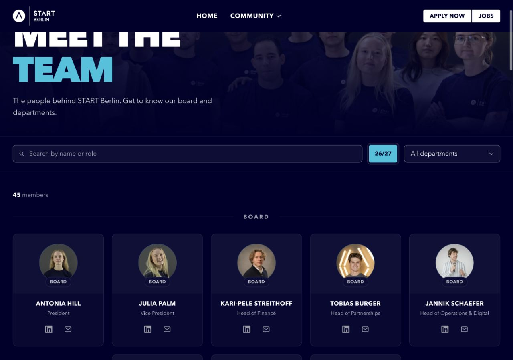
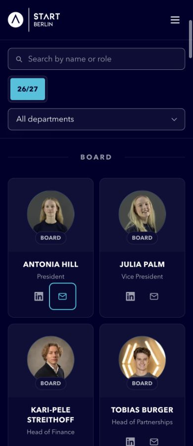

# Member contact links

Verified 5 October 2026 in Chrome against the isolated `.astro/member-contacts-build` output, served at `http://127.0.0.1:4339/members`.

## Data and behavior

All 45 current website members were matched by name to the live Cockpit Admin > People > Members list. Each address was read from the member's START Email field, with the detail heading checked against the requested name. All 45 addresses use `start-berlin.com`, with no missing or duplicate addresses. Personal contact fields were not copied into the website. No Cockpit record was changed.

The shared profile source holds 45 mail contacts, 44 LinkedIn destinations and 43 portrait references. The existing LinkedIn/portrait fields match their previous records exactly. Seoyoung's new record contains only the confirmed START email. All 50 rendered mail links match the source, including the five heads listed twice. Mail links open the user's mail handler; delivery was not tested and no message was sent.

## Browser checks

| Check | Result |
| --- | --- |
| Responsive cards | 15 passing views, all 50 cards per view |
| CSS widths | 320, 359, 360, 390, 639, 640, 767, 768, 1023, 1024, 1280, 1440, 1920 |
| Landscape | 844 × 390 and 1024 × 768 |
| Doubled text | Seven passing views at 320, 390, 768, 1024, 1280, 1440, 1920 |
| Contact controls | Separate 44-pixel targets, names, decorative SVGs, no overlap |
| Keyboard | LinkedIn/mail order, visible focus and unobscured targets |
| Filters/search | All six groups, reset, duplicate head count, mail-only profile, empty results |
| Icon contrast | 7.14:1 against the card surface; focus outline 9.05:1 |
| Console | No captured warnings or errors |

The browser had 110-percent page zoom. Viewport overrides were adjusted and actual `innerWidth`/`innerHeight` checked to obtain the listed CSS dimensions. Temporary overrides were reset after verification. Doubled-text checks used a temporary copy of the built Members HTML with a 32-pixel root font; the fixture was removed afterward. Native accessibility names and SVG states were inspected. Screen-reader speech and operating-system reduced-motion settings were not audited.

Machine-readable evidence: [responsive views](browser-views.json), [enlarged text](text-zoom.json), [interactions and destination comparison](interactions.json), [contrast](contrast.json), [source checks](source-checks.json).

## Code checks

`check:design` passes with 21 stylesheets/blocks and 122 defined custom properties. Astro checks 59 files with zero errors and warnings; three existing Zod hints remain. The isolated production build passes. No Jobboard behavior changed. Tracked `dist/`, lockfiles and unrelated local work were preserved. The task does not establish production deployment.

[Typecheck output](typecheck.log) and [build output](build.log).

